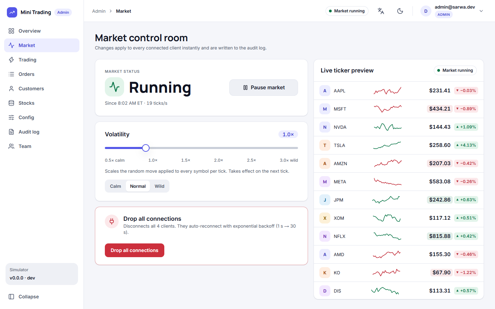
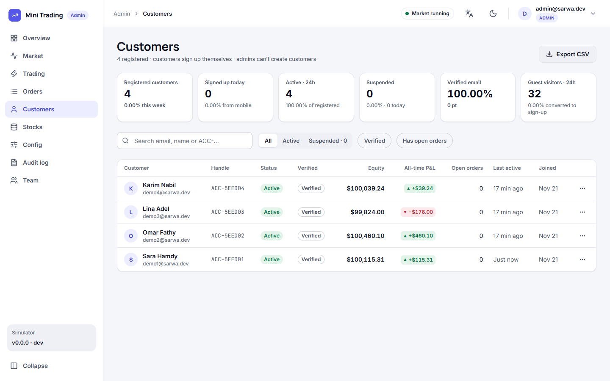
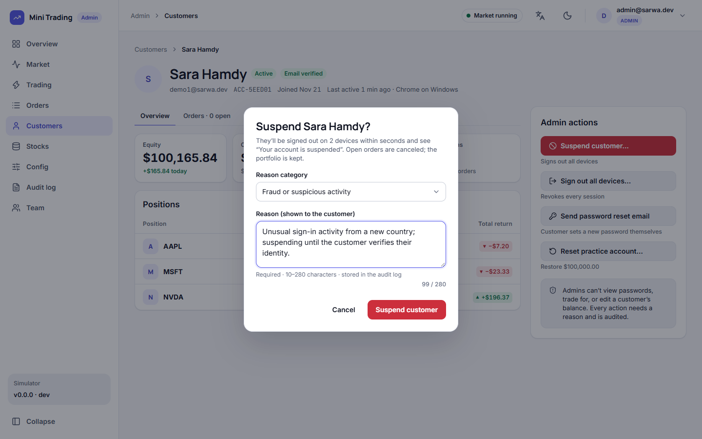
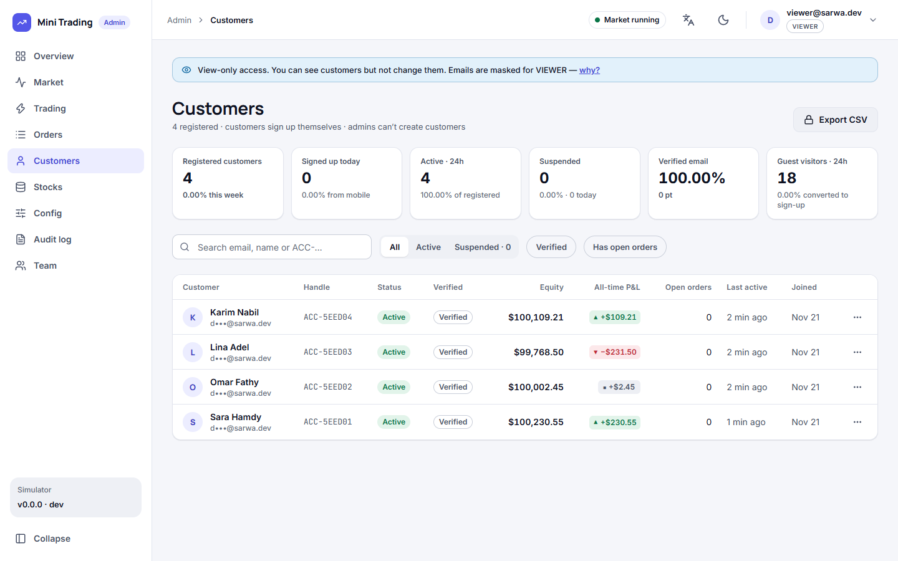
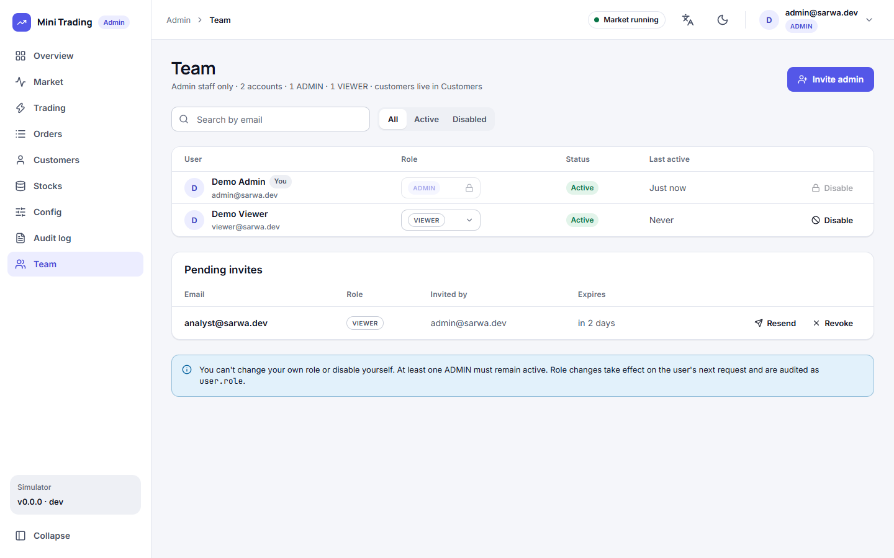
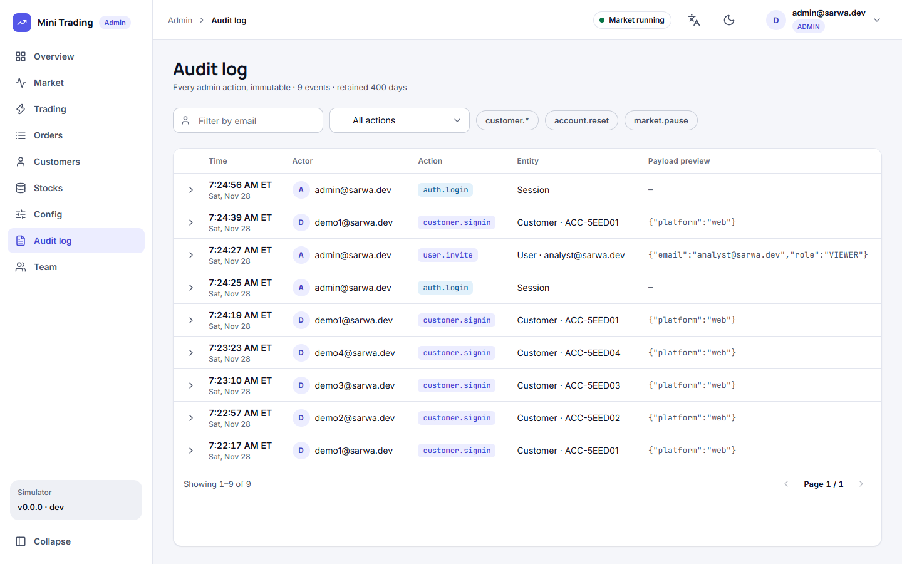

# @sarwa/admin

The admin dashboard, a separate Next.js 16 app. Admins use it to watch the market and the platform, manage stocks, trading rules, halts, customers, orders, the team and invites, and to read the audit log. There are two roles: ADMIN (full access) and VIEWER (read-only, with PII masked by the server).

## Screenshots

Light or dark follows your GitHub theme.

<table>
  <tr>
    <td width="50%"> Market control room: pause the market, set volatility, drop all connections, live ticker.</td>
    <td width="50%"> Customers: sign-up and activity stats, filters, and the customer table.</td>
  </tr>
  <tr>
    <td width="50%"> Customer actions: suspending a customer needs a reason category and a message.</td>
    <td width="50%"> VIEWER role: read-only banner and masked customer emails.</td>
  </tr>
  <tr>
    <td width="50%"> Team: staff roles, disable access, and pending invites.</td>
    <td width="50%"> Audit log: every admin action with actor, entity and payload.</td>
  </tr>
</table>

## Run, test, build

| Task               | In this folder                                                | From the root                                         |
| ------------------ | ------------------------------------------------------------- | ----------------------------------------------------- |
| Dev on port 3001   | `pnpm dev`                                                    | `pnpm turbo run dev --filter=@sarwa/admin`            |
| Test (Jest, jsdom) | `pnpm test`                                                   | `pnpm turbo run test --filter=@sarwa/admin`           |
| Build / start      | `pnpm build`, then `pnpm start`                               | `pnpm turbo run build --filter=@sarwa/admin`          |
| Lint / typecheck   | `pnpm lint`, `pnpm typecheck` (both run `next typegen` first) | `pnpm turbo run lint typecheck --filter=@sarwa/admin` |

Sign in with the seeded `admin@sarwa.dev` / `admin12345` or `viewer@sarwa.dev` / `viewer12345` (see the [server README](../server/README.md)).

## Env

- `API_URL`: where the `/api/*` and `/socket.io/` rewrites in `next.config.ts` send requests (default `http://localhost:4000`).
- `NEXT_PUBLIC_WEB_URL`: the customer web app, used to link to a customer's pages (default `http://localhost:3000`).

All API and socket traffic goes through this origin. The admin session cookie (`sarwa_admin_session`, `SameSite=Strict`) therefore works without CORS. The socket uses polling, then WebSocket.

## Structure

- `src/app/`: `login`, `invite`, and the `(dashboard)` routes: overview, market, trading, stocks, orders, customers, team, config, audit.
- `src/features/<area>/`: one `use-*-page.ts` view-model per screen, plus `.tsx` files that only render.
- `src/components/`: layout and shared pieces (access gates, confirm dialog, toasts, ticker).
- `src/lib/client.ts`: builds the `@sarwa/core` client and the admin API and socket from `@sarwa/core/admin`. A 401 sends the user to `/login?next=...`.
- `src/proxy.ts`: the nonce CSP, plus an optimistic redirect to `/login` when the session cookie is missing. The API still checks every request.
- `test/`: Jest tests, which mirror `src/`.

## Boundaries

The admin app is the only app that may import `@sarwa/core/admin`. It also uses `@sarwa/core`, `@sarwa/ui`, `@sarwa/contracts` and `@sarwa/tokens`. Render-only files and `use-*.ts` view-models never import React Query or `useSarwa` directly. No hex colours or font-file names in components.

See the [root README](../../README.md), [architecture](../../docs/architecture.md), and ADRs [0002](../../docs/adr/0002-expo-mobile-nextjs-web-and-admin.md), [0003](../../docs/adr/0003-share-logic-not-ui.md), [0012](../../docs/adr/0012-admin-dashboard-separate-app.md) and [0013](../../docs/adr/0013-security-headers-csp-client-ip-rate-limits.md).
