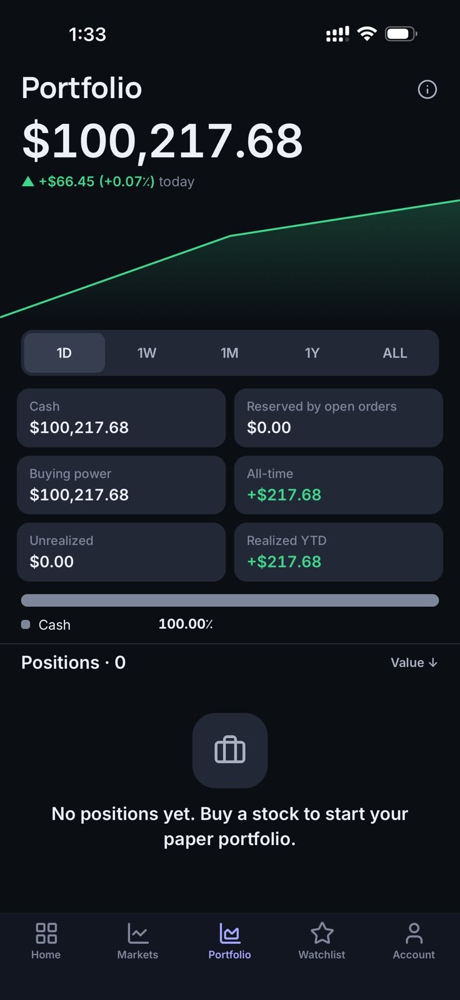
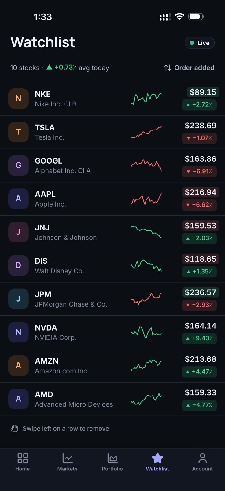
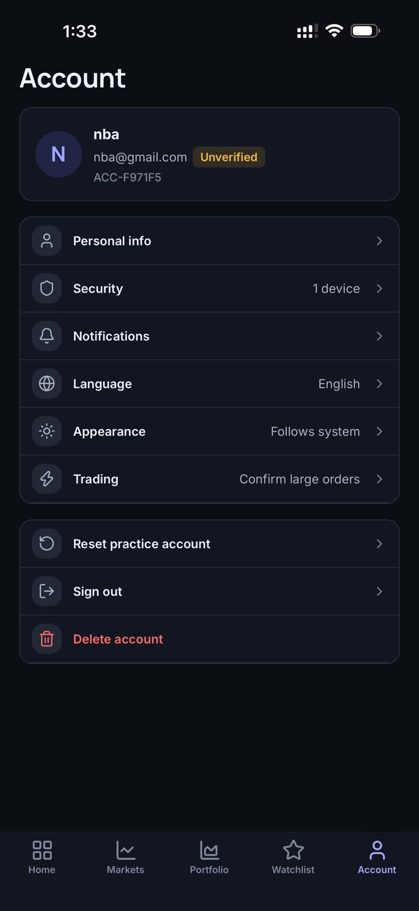

# @sarwa/mobile

The customer mobile app, built with Expo SDK 58, Expo Router and NativeWind. It offers the same features as the web app (markets, live prices, watchlist, trading, alerts, portfolio) and uses only libraries that run in Expo Go.

## Screenshots

Taken on a real phone in dark mode.

<table>
  <tr>
    <td width="33%"> Portfolio: equity chart, cash, buying power and P&amp;L.</td>
    <td width="33%"> Watchlist: live prices, sparklines, swipe to remove.</td>
    <td width="33%"> Account: profile, security, language, appearance and trading settings.</td>
  </tr>
</table>

## Run, test, lint

| Task                    | In this folder                                            | From the root                                          |
| ----------------------- | --------------------------------------------------------- | ------------------------------------------------------ |
| Start Metro (port 8081) | `pnpm dev` (`expo start`), or `pnpm android` / `pnpm ios` | `pnpm --filter @sarwa/mobile dev`                      |
| Test (`jest-expo`)      | `pnpm test`                                               | `pnpm turbo run test --filter=@sarwa/mobile`           |
| Lint / typecheck        | `pnpm lint`, `pnpm typecheck`                             | `pnpm turbo run lint typecheck --filter=@sarwa/mobile` |

There is no `build` script. Release builds go through EAS (`eas.json`). The app reads `@sarwa/contracts` and `@sarwa/tokens` from `dist`, and `@sarwa/domain` and `@sarwa/i18n` (through core) from `dist` too, so build them first when you run Expo outside turbo: `pnpm turbo run build --filter=@sarwa/mobile^...`. Root `pnpm dev` does this for you.

## Expo Go on the same Wi-Fi

1. Start the API: root `pnpm dev`, or `pnpm turbo run dev --filter=@sarwa/server`. It listens on `0.0.0.0:4000`.
2. Start Metro with `pnpm --filter @sarwa/mobile dev` and scan the QR code with Expo Go. The phone and the computer must be on the same network, and the firewall must allow ports 8081 and 4000.

`src/lib/api-url.ts` resolves the API URL:

- **Development:** `EXPO_PUBLIC_API_URL` if it is set. Otherwise it takes the host from Expo's `hostUri` (the dev machine's LAN IP that the bundler uses) and adds port 4000, so `http://<lan-ip>:4000`. It falls back to `localhost`.
- **Release:** `EXPO_PUBLIC_API_URL` is required and must use `https://`. Otherwise the app throws at start.

`EXPO_PUBLIC_WEB_URL` (default `http://localhost:3000`) builds share links to the web app. The EAS profiles set both variables.

## Structure

- `src/app/`: Expo Router routes: `(tabs)` (home, markets, watchlist, portfolio, account), `(auth)`, stock, order, orders, alerts, settings.
- `src/features/<area>/`: one `use-*-screen.ts` view-model per screen, plus `.tsx` files that only render.
- `src/components/`: `ui/` primitives (`text.tsx` maps text variants to font files), `layout/`, and `trading/` (the memoized `StockRow`, price flash, sparkline).
- `src/lib/client.ts`: the `@sarwa/core` client with bearer auth. Tokens and the device id are kept in SecureStore, preferences in AsyncStorage.
- `src/lib/theme.ts`: NativeWind theme variables from `@sarwa/tokens`. `src/providers/`: app providers.
- `test/`: Jest tests, which mirror `src/`.

## Boundaries

The app may use `@sarwa/core`, `@sarwa/contracts` and `@sarwa/tokens`. Lint blocks `@sarwa/core/admin`. The app does not depend on `@sarwa/ui`, which is DOM-only. Render-only files and `use-*.ts` view-models never import React Query or `useSarwa` directly. No hex colours or font-file names outside `src/components/ui/text.tsx`.

See the [root README](../../README.md), [architecture](../../docs/architecture.md), and ADRs [0002](../../docs/adr/0002-expo-mobile-nextjs-web-and-admin.md), [0003](../../docs/adr/0003-share-logic-not-ui.md), [0006](../../docs/adr/0006-realtime-socketio-snapshot-stream.md), [0008](../../docs/adr/0008-customer-accounts-and-sessions.md) and [0010](../../docs/adr/0010-arabic-and-rtl-first-class.md).
