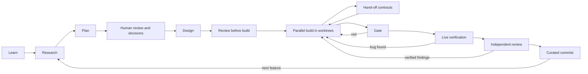

# Workflow

The same loop ran for every large piece of work: the first build, the shared-core refactor, the five-way review, customer accounts and the guest watchlist. Small fixes skipped stages; nothing skipped the gate.

**One real pass.** I asked for a plan in a prompt: five read-only reviews merged into one phased plan → the AI produced [04-master-plan.md](prompts/04-master-plan.md) with tagged findings and open questions Q1–Q4 → I reviewed it, answered Q1–Q4 and later reversed Q2 (guest watchlist) based on the brief → the decisions were frozen in [07-wave2-decisions.md](prompts/07-wave2-decisions.md) and [agent-rules](prompts/agent-rules.md) → only then did the wave-2 build start.

## Stages

### 1. Learn

- **AI:** acted as a tutor for the areas I hadn't worked in (React Native and Expo, a NestJS backend): explaining concepts through what I know from web React, answering "why" questions, and comparing options with their trade-offs. See [LEARNING.md](LEARNING.md).
- **Human:** took video courses for the foundations, asked questions until each part made sense, then built that part.
- **Artifact:** the decisions it shaped, listed in [LEARNING.md](LEARNING.md).
- **Example:** learning how lists, networking, storage and security work on mobile led to FlashList for long lists, pausing the socket only when the app goes to the background, and SecureStore for tokens.

### 2. Research

- **AI:** researched how real products solve the problem before proposing anything.
- **Human:** chose which model to follow.
- **Artifact:** the product-context section of [03-design-accounts-and-auth.md](prompts/03-design-accounts-and-auth.md).
- **Example:** before customer accounts, the AI looked at how brokers such as Robinhood, eToro and Trading 212 handle guests, self sign-up, gating at the moment of a personal action, one account across devices, and admin-side suspension. That became the product rules in the design brief.

### 3. Plan

- **AI:** wrote the implementation spec and a milestone plan, M0–M9 (tooling, contracts, server, core, ui, mobile, web, admin, docs, verification). Later, focused improvement prompts for each follow-up.
- **Human:** read the plan end to end before any code.
- **Artifact:** the spec (outside the repo), then [01](prompts/01-fix-parity-and-clean-core.md) and [02](prompts/02-trading-v2-review-fixes.md).
- **Example:** after the milestones, 01 moved duplicated logic into `@sarwa/core` and brought mobile to parity with web; 02 closed what an independent review found in Trading v2, money correctness first.

### 4. Human review and decisions

- **AI:** laid out options and trade-offs, then recorded the decisions so later agents couldn't reopen them.
- **Human:** made the calls.
- **Artifact:** "User decisions" in [04-master-plan.md](prompts/04-master-plan.md), [07-wave2-decisions.md](prompts/07-wave2-decisions.md), "Already decided" in [agent-rules.md](prompts/agent-rules.md).
- **Example:** on the first plan the developer chose a frontend-heavy focus, a simple but real backend with a database instead of mocks, Jest everywhere (the first study material assumed Vitest, so this changed it), a full admin dashboard, and that the human makes the commits.

### 5. Design

- **AI:** wrote a brief for Claude Design; once the boards existed, digested them into a written spec before any code.
- **Human:** reviewed the boards in the UI kit and the gap list.
- **Artifact:** [03](prompts/03-design-accounts-and-auth.md) (brief) and [05-accounts-design-spec.md](prompts/05-accounts-design-spec.md) (spec).
- **Example:** 05 lists every route, state and copy key from the boards, the API they imply, and gaps G1–G30 with a recommended resolution each. The human still decided each one: for G18 (session locations had no data source) 05 recommended offline GeoIP, and [07](prompts/07-wave2-decisions.md) chose no GeoIP, so a session shows the device label plus a masked IP.

### 6. Review before build

- **AI:** ran parallel read-only reviewers over the whole codebase before the accounts work, then merged their findings into one phased plan.
- **Human:** checked the merged plan and answered the open questions.
- **Artifact:** [04-master-plan.md](prompts/04-master-plan.md), phases 0–5.
- **Example:** five reviewers, split by area (server, shared packages, web, mobile, admin and tooling) and covering business, architecture/SOLID, security, performance, and responsive/SEO. Every finding is tagged **V** (verified in code or with curl) or **S** (suspected, must be proven by a failing test first). One V finding: `/admin/accounts` returned 500 because each account opened its own transaction; the plan replaced it with a batched reader and a test that seeds 300+ accounts.

### 7. Parallel build in worktrees

- **AI:** the coordinator split each phase into independent briefs; worker agents ran in parallel, each in its own git worktree and branch, with an explicit list of files it owns.
- **Human:** approved the split and the file scopes.
- **Artifact:** [agent-rules.md](prompts/agent-rules.md), [agent-brief-template.md](prompts/agent-brief-template.md), [the guest-watchlist server brief](prompts/brief-example-guest-watchlist-server.md).
- **Example:** wave 1 ran server architecture, shared core, mobile platform, web SEO/responsive, admin responsive, tooling/CI and a flaky-test fix side by side. Wave 2 (customer accounts) went contracts/domain/i18n → server auth (argon2id, sessions, refresh rotation, admin customers, invites) → core session and gating → client UI, first render-only from the design, then wired.

### 8. Hand-off contracts

- **AI:** the agent that finishes a layer writes down its public surface for the agents that consume it.
- **Human:** nothing, unless a contract needed a decision.
- **Artifact:** [08-client-integration-guide.md](prompts/08-client-integration-guide.md) (from the core agent), [09-server-api-notes.md](prompts/09-server-api-notes.md) (from the server agent).
- **Example:** with 08 and 09 in hand, the web, mobile and admin agents built auth screens, gating and the Customers pages at the same time, without reading each other's code or waiting on a merge.

### 9. Gate

- **AI:** every worker ran the gate on its workspace before reporting; the coordinator re-ran it after each merge.
- **Human:** treated a green gate, not an agent's report, as "done".
- **Artifact:** the root scripts `typecheck`, `lint`, `test:coverage`, `build`, and the CI workflow that runs the same `test:coverage` script.
- **Example:** coverage once passed locally and failed in CI. swc compiles `export const` to getters, so an export no test reads counts as uncovered. The fix became two rules: a test for every export, and one `test:coverage` script shared by local runs and CI.

### 10. Live verification

- **AI:** drove a real browser against production builds of the apps, on separate ports, through the real Next rewrites.
- **Human:** asked for it, and repeated the flows by hand with [10-manual-test-guide.md](prompts/10-manual-test-guide.md).
- **Artifact:** the manual test guide; the fixes and their tests.
- **Example:** two production-only bugs that every mocked test missed: all settings pages returned 500 because a server component imported a constant from a client module, and the SSR snapshot was empty with a hydration error. Follow-up agents then fixed `X-Forwarded-For` spoofing through the Next rewrites, added the admin nonce CSP, and made the guest first load fast (see the [Lighthouse results](../performance/lighthouse/README.md)). The guest watchlist was checked live in 8 scenarios.

### 11. Independent review

- **AI:** six read-only reviewers, each with a fresh context and no stake in the code.
- **Human:** decided what to fix.
- **Artifact:** the fixes, each with the test that failed first.
- **Example:** every finding was reproduced before it was fixed. Six were real bugs and were fixed in parallel, each starting with a failing test. One sub-claim turned out to be false and was skipped.

### 12. Curated commits

- **AI:** proposed the commit plan and proved it before anyone ran it.
- **Human:** ran the commits and pushed.
- **Artifact:** [06-commit-plan.md](prompts/06-commit-plan.md) (wave 1: 8 commits), [11-final-commit-plan.md](prompts/11-final-commit-plan.md) (release: 12 commits).
- **Example:** before the release, one final full gate ran (typecheck, lint, `test:coverage`, build; 2,110 tests). The commit plan was simulated on a temporary git index to prove every changed file lands in exactly one commit. A backup branch kept the original history for a final diff. The pre-commit hook hit the Windows command-line limit in lint-staged; `--max-arg-length 4000` fixed it.

The documentation in this repo was produced the same way: parallel writer agents (ADRs, AI workflow, security and performance, workspace READMEs, the README), a screenshot agent for real light and dark captures, and three independent reviewers (compliance with the agreed scope, a fact-check of every claim against the code, and rendering and links) before anything was committed.

## Coordinator + workers

The main session is a coordinator. It does four things: **plan, brief, merge, verify.** It does not write feature code during a parallel wave. Workers execute.

|           | Coordinator (main session)                  | Worker (implementer agent)                                          |
| --------- | ------------------------------------------- | ------------------------------------------------------------------- |
| Input     | The plan, decisions, review findings        | One brief + `agent-rules.md`                                        |
| Workspace | The integration branch                      | Its own git worktree and branch                                     |
| Writes    | Briefs, plans, decision records, merges     | Code and tests inside its owned files only                          |
| Output    | A merged, gated branch                      | Local commits + a report (log, gate numbers, out-of-scope findings) |
| Never     | Trusts a report without re-running the gate | Pushes, stashes, edits outside its scope                            |

Why this shape:

- **Parallelism.** Independent areas (server, core, web, mobile, admin, tooling) build at the same time. Hand-off contracts remove the waiting between layers.
- **A clean context per task.** A worker sees one brief, the rules and its files, not the whole history of the conversation. It stays focused, and its mistakes don't leak into the next task. The coordinator keeps the long context: decisions, open questions, what was merged.
- **No file collisions.** Each worktree has its own checkout, and each brief lists owned and forbidden files, so two agents never edit the same file. Out-of-scope needs go in the report, and the coordinator decides. Shared git state is the one place isolation leaks (the stash list, temp files), and the rules cover it; see [LESSONS.md](LESSONS.md).
- **Verification stays independent.** The agent that wrote the code is not the one that declares it done. The coordinator re-runs the gate after each merge, and review agents read with a fresh context.
