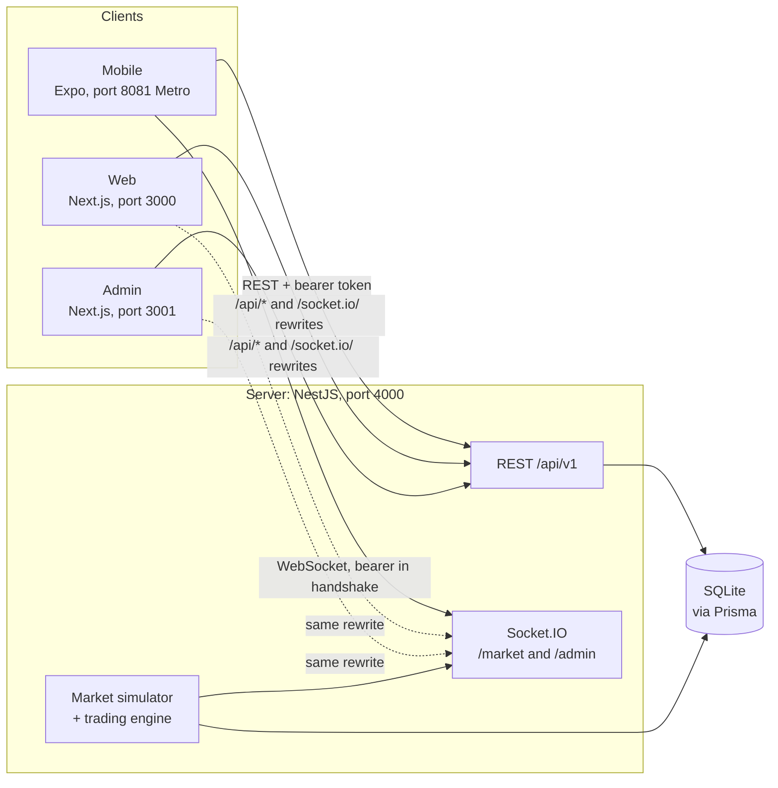
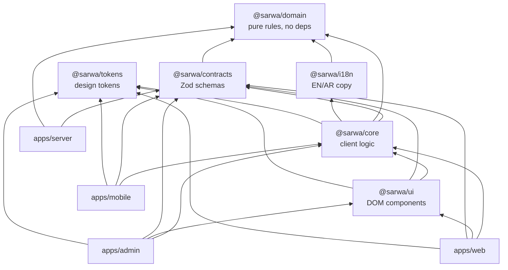
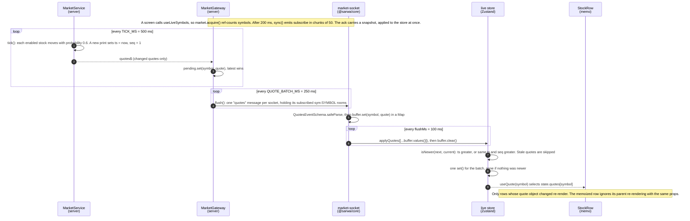
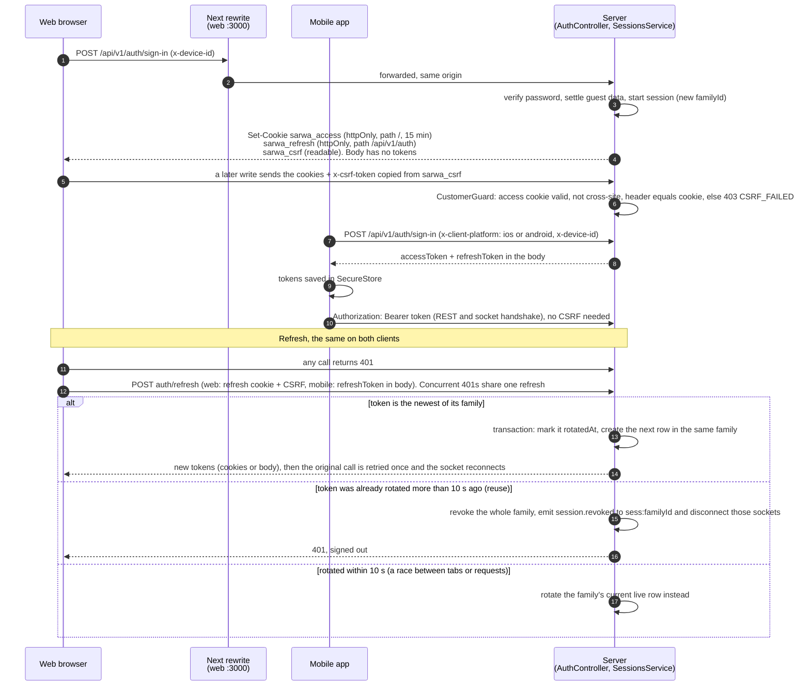
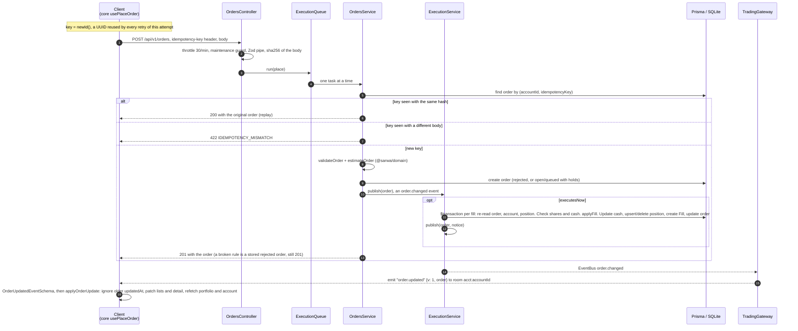
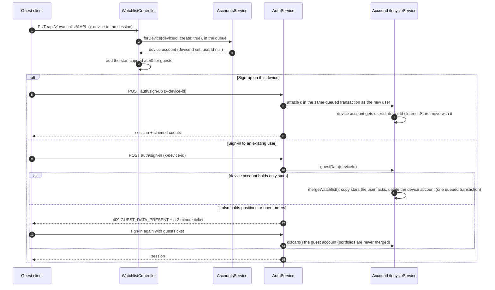

# Architecture

How the Sarwa Mini Trading monorepo fits together: the running system, the package graph and its boundaries, and the four flows worth knowing before you change anything. Every number below comes from the code; the file that owns it is named next to it. Decisions and their trade-offs live in the [ADRs](adr/README.md); setup is in the [root README](../README.md).

## System context

- **Web and admin** call the API on their own origin. `next.config.ts` rewrites `/api/:path*` and `/socket.io/` to `API_URL` (default `http://localhost:4000`), so session cookies stay first-party and need no CORS. Their sockets start with polling, then upgrade to WebSocket. The web app's Server Components also fetch market snapshots straight from `API_URL`, cached for 5 s (`apps/web/src/lib/server-api.ts`).
- **Mobile** talks to the API directly. It uses a bearer token for REST and the socket handshake, and WebSocket transport only. In development `EXPO_PUBLIC_API_URL` wins if it is set; otherwise the URL comes from Expo's `hostUri`, so a phone on the same Wi-Fi works (`apps/mobile/src/lib/api-url.ts`).
- **Server** listens on `0.0.0.0:4000`. Customer quote, order and session events share the `/market` namespace, and the dashboard uses `/admin`. One process owns the simulator, the execution queue, socket rooms and rate limits (see the ADR index note on a single server instance).

## Packages and boundaries

Arrows point at a dependency. `@sarwa/eslint-config` and `@sarwa/tsconfig` are dev dependencies of every app and library; so is `@sarwa/jest-config`, except mobile, which uses `jest-expo`. `domain`, `contracts`, `i18n` and `tokens` build to `dist/`. `core` and `ui` ship TypeScript source.

The rules are lint errors. They live in `packages/eslint-config/base.js` and each workspace's `eslint.config.mjs` ([details](../packages/eslint-config/README.md)):

- Apps are leaves: nothing imports an app. Packages are imported through public entry points only (no `@sarwa/*/src` or `dist` paths).
- `domain` imports no packages. `contracts` has lint deny-lists (React, Socket.IO, TanStack and every `@sarwa/*` package except `domain`); its runtime dependencies are `zod` and `domain`. `i18n` imports only `domain`.
- `core` is platform-free: no React Native, Expo, Next.js, `react-dom` or `@sarwa/ui`. Its `server.ts` and `pure.ts` entries are React-free.
- `ui` is presentational: it may use `@sarwa/core/pure`, but not the hooks entry, `@sarwa/core/admin` or React Query.
- The server's workspace dependencies are `contracts` and `domain`; it imports no client package.
- Customer apps never import `@sarwa/core/admin`. In every app, render-only files and `use-*.ts` view-models never import React Query or `useSarwa`. Components never contain hex colours or font-file names.

## The journey of a price

| Step                                                                      | Where                                                                                               |
| ------------------------------------------------------------------------- | --------------------------------------------------------------------------------------------------- |
| `TICK_MS = 500`, `QUOTE_BATCH_MS = 250`, `MAX_SUBSCRIBE_SYMBOLS = 50`     | `packages/contracts/src/constants.ts`                                                               |
| `tick()`, `MOVE_PROBABILITY = 0.6`, `trade()` sets `ts` and `seq`         | `apps/server/src/market/market.service.ts`                                                          |
| `pending` map, `flush()` per socket, `sym:` rooms, subscribe ack snapshot | `apps/server/src/market/market.gateway.ts`                                                          |
| `buffer` map, `flushMs = 100`, `syncDelayMs = 200`, chunked subscribe     | `packages/core/src/market-socket.ts`                                                                |
| `isNewer`, `applyQuotes`                                                  | `packages/core/src/store.ts`                                                                        |
| `useQuote`, `useLiveSymbols`                                              | `packages/core/src/hooks/live.ts`                                                                   |
| `StockRow = memo(...)`, `useQuote(stock.symbol)`                          | `apps/web/src/components/trading/stock-row.tsx`, `apps/mobile/src/components/trading/stock-row.tsx` |

The gateway joins sockets to `sym:SYMBOL` rooms to record what each one wants. The flush itself loops over the sockets and sends each one a single batch, rather than emitting to each room. The same `quotes$` stream also feeds `EngineService`, which works resting orders on each tick.

## Sign-in and refresh

- Refresh lifetimes are 1 day, or 30 days with "keep me signed in" (`AUTH_TTL_MS` in `packages/contracts/src/constants.ts`). Every access-token check also confirms that the family is still live, so a revoke takes effect at once (`SessionsService.authenticate`).
- Code: `apps/server/src/auth/transport.ts` (cookies vs body, CSRF), `auth/sessions.service.ts` (`REUSE_GRACE_MS = 10_000`, rotation), `auth/customer.guard.ts`, `common/same-origin.guard.ts`, `packages/core/src/auth/transport.ts` (`webCookieAuth`, `bearerAuth`), `packages/core/src/auth/session.ts` (`createSessionAuth`), `packages/core/src/api.ts` (retry after refresh).

## Order execution

- Resting orders (limits, stops, partial fills) are worked by `EngineService`. It subscribes to `quotes$`, queues one `processQuotes` batch on the same `ExecutionQueue`, and works each symbol's orders oldest first against the displayed size.
- Every write to accounts, orders and positions goes through the one queue (`apps/server/src/trading/execution-queue.ts`). Fills, cancels, placements and resets therefore never interleave.
- The REST answer and the socket event both go through `applyOrderUpdate` (`packages/core/src/hooks/order-cache.ts`), so whichever arrives first wins and the other is a no-op.
- Code: `trading/orders.controller.ts`, `trading/orders.service.ts`, `trading/execution.service.ts`, `trading/engine.service.ts`, `trading/trading.gateway.ts`, `common/events.ts`.

## Guest watchlist

The device id is a UUID that `@sarwa/core` creates once and keeps in the client's storage (SecureStore on mobile). Admin metrics count only stars on accounts with a user. Code: `apps/server/src/watchlist/watchlist.module.ts`, `trading/accounts.service.ts`, `trading/account-lifecycle.service.ts`, `auth/auth.service.ts`. See [ADR 0009](adr/0009-guest-watchlist-device-account.md).

## Where to start reading the code

1. `packages/contracts/src/constants.ts`: the shared numbers, names and TTLs that both sides agree on.
2. `packages/domain/src/money.ts`: branded integer money, used by every other rule.
3. `packages/domain/src/execution.ts`: `applyFill` and fill pricing, the heart of the engine.
4. `apps/server/src/app.module.ts`: every server module and the global guards on one page.
5. `apps/server/src/market/market.service.ts`: the simulator and the `quotes$` stream.
6. `apps/server/src/trading/orders.service.ts`: placing an order inside the execution queue.
7. `apps/server/src/auth/sessions.service.ts`: refresh rotation and reuse detection.
8. `packages/core/src/client.ts`: how one client wires the store, socket and API for every app.
9. `packages/core/src/market-socket.ts`: subscriptions, buffering and trading events on the client.
10. `apps/web/src/features/markets/use-markets-page.ts`: a typical screen view-model, rendered by `markets-page.tsx`.
